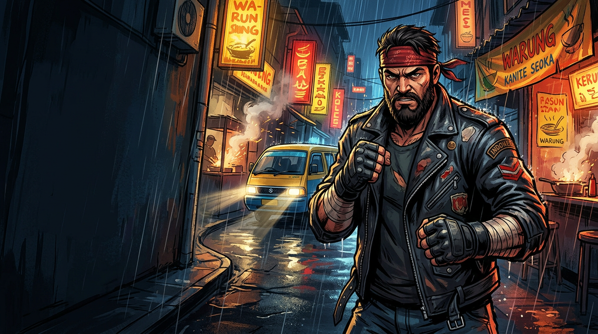
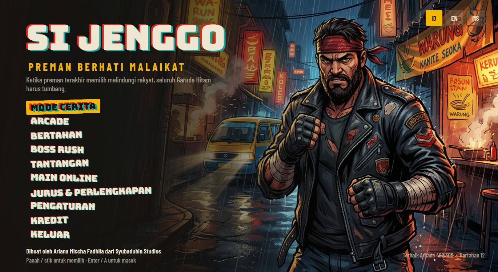
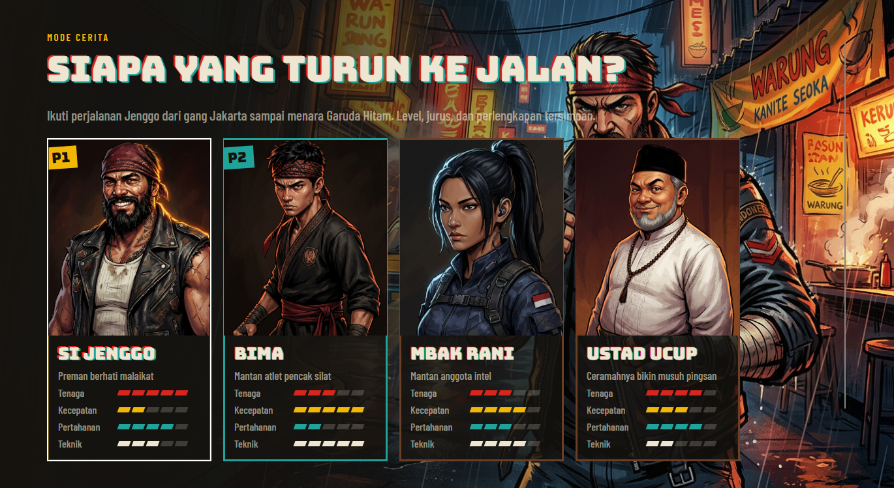
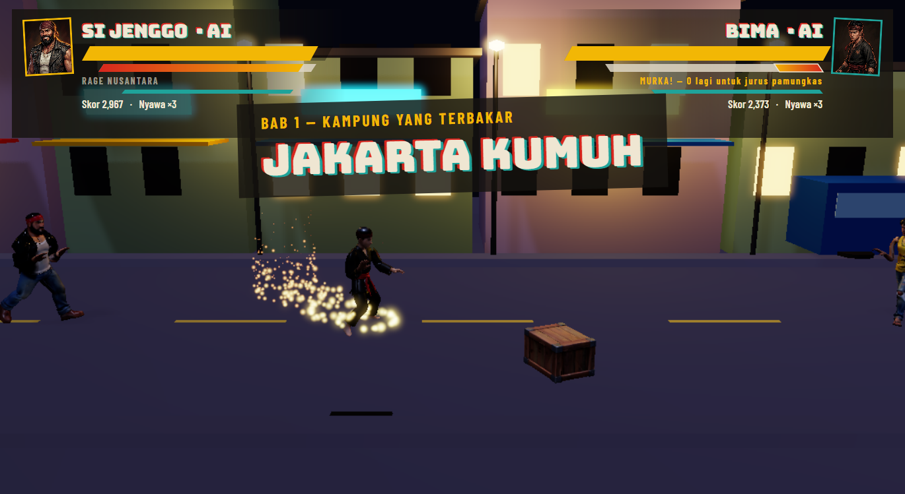
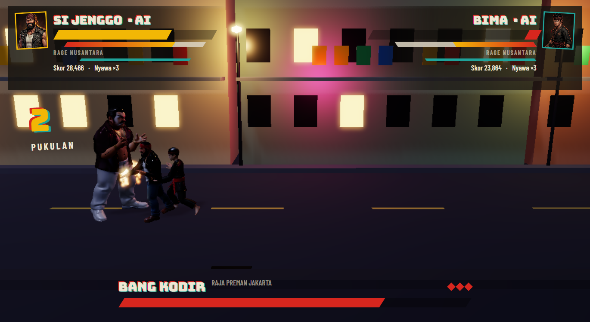
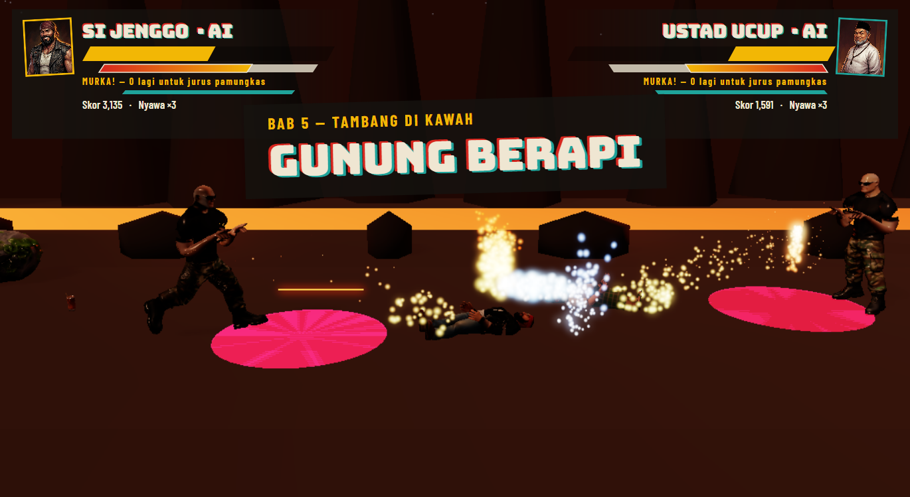
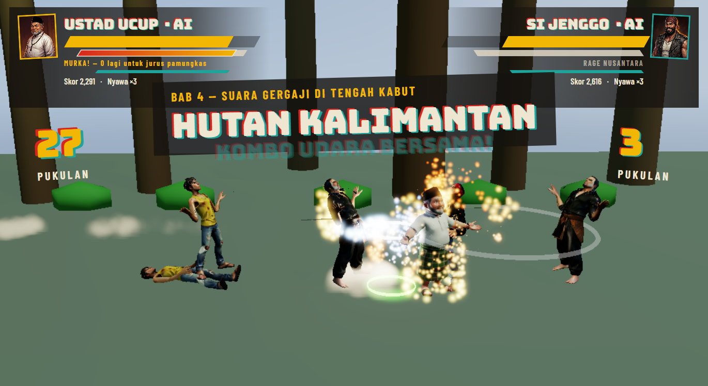
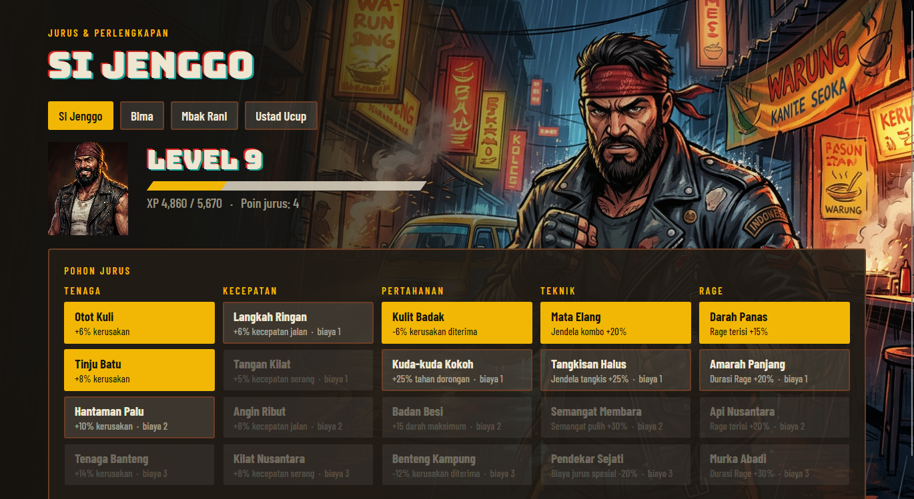
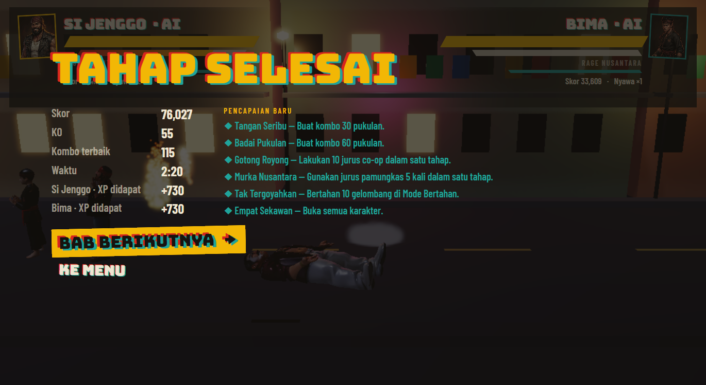

# Si Jenggo — Preman Berhati Malaikat



> *"Ketika preman terakhir memilih melindungi rakyat, seluruh Garuda Hitam harus tumbang."*
> *"When the last thug chooses to protect the people, all of Garuda Hitam must fall."*

**Dibuat oleh Ariana Mischa Fadhila dari Syubadubin Studios** · *Made by Ariana Mischa Fadhila of Syubadubin Studios*

A 3D side-scrolling beat 'em up set across Indonesia, built on **.NET 10**, **ThreeNet** (Rust + wgpu
rendering behind a Three.js-style C# API) and **Avalonia UI**.
· Beat 'em up 3D side-scrolling berlatar Indonesia, dibangun dengan **.NET 10**, **ThreeNet**, dan **Avalonia UI**.

**⬇ Download / Unduh v0.1.1:** [Windows](https://github.com/SyubadubinStudios/SiJenggo/releases/download/v0.1.1/SiJenggo-0.1.1-win-x64-setup.exe) · [Debian/Ubuntu](https://github.com/SyubadubinStudios/SiJenggo/releases/download/v0.1.1/sijenggo_0.1.1_amd64.deb) · [Linux](https://github.com/SyubadubinStudios/SiJenggo/releases/download/v0.1.1/SiJenggo-0.1.1-linux-x64.tar.gz) · [macOS Apple silicon](https://github.com/SyubadubinStudios/SiJenggo/releases/download/v0.1.1/SiJenggo-0.1.1-macos-arm64.zip) · [macOS Intel](https://github.com/SyubadubinStudios/SiJenggo/releases/download/v0.1.1/SiJenggo-0.1.1-macos-x64.zip) · [Android](https://github.com/SyubadubinStudios/SiJenggo/releases/download/v0.1.1/SiJenggo-0.1.1-android.apk)

[English](#english) · [Bahasa Indonesia](#bahasa-indonesia) · Docs: [EN](docs/en/README.md) / [ID](docs/id/README.md)

| | |
|---|---|
|  |  |
|  |  |
|  |  |
|  |  |

---

## English

### What is in the game

- **4 fighters**: Si Jenggo (power grappler), Bima (fast silat combos and counters), Mbak Rani (traps and
  gadgets, unlocked after chapter 3) and Ustad Ucup (improvised weapons, unlocked after chapter 5). Each has a
  light combo chain, heavy and dash attacks, air attacks, grabs and throws, a counter, three specials and an ultimate.
- **7 chapters** from the Jakarta slums to Garuda Hitam's future city, each with its own areas, weather
  (neon night, rain, thunderstorm, mist, volcanic ash), ambient hazards and a **3-phase boss** with a cinematic
  intro, a unique arena mechanic and a phase "destruction sequence".
- **Rage Nusantara**: dealing and taking damage fills the meter; activate it for more damage, speed, endless
  combo chains and free specials, then press again for the ultimate (Murka Nusantara, Seribu Bayangan, Operasi
  Elang Malam, Ceramah Kiamat).
- **Jurus daerah**: each chapter teaches a regional style (Silat Betawi, Debus Banten, Pencak Jawa Barat,
  Silat Minang, Silat Bugis, Silat Bali), equipped as Special + down.
- **Traditional weapons** with their own combos: golok, keris, kujang, celurit, rencong, tombak Dayak, mandau (and an iron pipe).
- **Environment**: chairs, scooters, food carts, bins, bamboo, fences, crates and boulders can be kicked,
  lifted and thrown.
- **Co-op**: 2 players local, 2 players online (deterministic lockstep or rollback, optional relay server), or
  player + AI partner. Co-op moves: double grab slam, air launch combo, team finisher, revive.
- **RPG lite**: XP and levels, a 20-node skill tree (Power, Speed, Defense, Technique, Rage) and boss-drop gear
  (jacket, belt, gloves, heirloom necklace).
- **Modes**: Story, Arcade, Survival, Boss Rush, Challenges. Achievements, save/profile system, Indonesian, English and Malay (Bahasa Melayu).
- **In-engine cutscenes**: every Story chapter opens with a camera tour of its own stage under the story
  subtitles; clearing a chapter leads straight into the next, and the last one ends with an epilogue.
- **Voice**: 48 recorded lines (every boss's intro, taunts and defeat, player barks) generated with ElevenLabs v3.
- **Signature animation**: Bima's kuda-kuda stance and sembah, Rani's earpiece and wrist gadget, Ucup's tasbih,
  sarong whirl and doa, Jenggo's brawler flex, and a unique intro for each boss.
- **Dynamic soundtrack**: funk rock, metal blues, surf rock, tribal percussion, gamelan metal and symphonic
  metal, synthesised at runtime in three stems that mix live with the fight's intensity.

### Download

Latest version: **[v0.1.1](https://github.com/SyubadubinStudios/SiJenggo/releases/tag/v0.1.1)** (older builds on the
[Releases](https://github.com/SyubadubinStudios/SiJenggo/releases) page). A GPU with DirectX 12, Metal or Vulkan is required.

| Platform | File | How |
|---|---|---|
| Windows 10/11 x64 | [`SiJenggo-0.1.1-win-x64-setup.exe`](https://github.com/SyubadubinStudios/SiJenggo/releases/download/v0.1.1/SiJenggo-0.1.1-win-x64-setup.exe) | Run the installer (per user, no admin). Or the [`SiJenggo-0.1.1-win-x64-portable.zip`](https://github.com/SyubadubinStudios/SiJenggo/releases/download/v0.1.1/SiJenggo-0.1.1-win-x64-portable.zip). |
| Debian / Ubuntu | [`sijenggo_0.1.1_amd64.deb`](https://github.com/SyubadubinStudios/SiJenggo/releases/download/v0.1.1/sijenggo_0.1.1_amd64.deb) | `sudo apt install ./sijenggo_0.1.1_amd64.deb`, then run `sijenggo` |
| Other Linux x64 | [`SiJenggo-0.1.1-linux-x64.tar.gz`](https://github.com/SyubadubinStudios/SiJenggo/releases/download/v0.1.1/SiJenggo-0.1.1-linux-x64.tar.gz) | Unpack, then `./install.sh` (per user) or run `./SiJenggo` |
| macOS (Apple silicon / Intel) | [`SiJenggo-0.1.1-macos-arm64.zip`](https://github.com/SyubadubinStudios/SiJenggo/releases/download/v0.1.1/SiJenggo-0.1.1-macos-arm64.zip) / [`SiJenggo-0.1.1-macos-x64.zip`](https://github.com/SyubadubinStudios/SiJenggo/releases/download/v0.1.1/SiJenggo-0.1.1-macos-x64.zip) | Unzip, move "Si Jenggo.app" to Applications, right-click > Open the first time (ad-hoc signed, not notarised) |
| Android 8+ | [`SiJenggo-0.1.1-android.apk`](https://github.com/SyubadubinStudios/SiJenggo/releases/download/v0.1.1/SiJenggo-0.1.1-android.apk) | Allow installing from this source and open the APK (preview: touch controls, Story mode) |

Optional online relay: [win-x64](https://github.com/SyubadubinStudios/SiJenggo/releases/download/v0.1.1/SiJenggo-Server-0.1.1-win-x64.zip) · [linux-x64](https://github.com/SyubadubinStudios/SiJenggo/releases/download/v0.1.1/SiJenggo-Server-0.1.1-linux-x64.zip) · [osx-arm64](https://github.com/SyubadubinStudios/SiJenggo/releases/download/v0.1.1/SiJenggo-Server-0.1.1-osx-arm64.zip). Checksums: [SHA256SUMS.txt](https://github.com/SyubadubinStudios/SiJenggo/releases/download/v0.1.1/SHA256SUMS.txt). Installers are built with
`python tools/packaging/build_release.py` (needs Inno Setup and rcodesign, see the script).

### Run it

Requirements: .NET 10 SDK and a GPU with DirectX 12, Metal or Vulkan.

```bash
dotnet run --project src/SiJenggo.App            # play
dotnet test                                       # 51 tests (simulation, rollback, languages, voice, cutscenes)
dotnet run --project src/SiJenggo.Server -- 27960 # optional online relay
dotnet run --project src/SiJenggo.App -- --capture docs/screenshots   # regenerate screenshots
dotnet run -c Release --project tools/SiJenggo.Balance   # headless AI balance sweep (docs/en/BALANCE.md)
dotnet build src/SiJenggo.Android -c Release      # Android APK (android workload; not yet tried on a device)
```

### Controls

| Action | Player 1 keyboard | Player 2 keyboard | Gamepad |
|---|---|---|---|
| Move | WASD | Arrows | Left stick / D-pad |
| Light attack (combo) | J | Num1 | X |
| Heavy / dash attack | K | Num2 | Y |
| Jump | Space / L | Num3 | A |
| Special (+ direction) | I | Num4 | B |
| Grab / pick up / throw / revive | U | Num5 | RB |
| Rage / ultimate | O | Num6 | RT |
| Dodge (+ light = counter) | Left Shift | Num0 | LB |
| Pause | Esc | — | Start |

### How it is built

```
src/SiJenggo.Core          ECS (sparse-set pools), deterministic RNG, fixed-step clock
src/SiJenggo.Game          the whole game simulation: data, systems, modes, save, lockstep (no rendering)
src/SiJenggo.Presentation  ThreeNet: actors + Blender clips, stages, VFX, camera, procedural audio
src/SiJenggo.App           Avalonia UI: menus, HUD, input, game loop, screenshot tour
src/SiJenggo.Server        optional UDP relay for online co-op
src/SiJenggo.Android       Android head: SurfaceView renderer, touch controls, Story mode
tests/SiJenggo.Tests       xUnit tests (simulation, rollback, localisation, voice and cutscene data)
tools/blender              asset pipeline + per-character animation styles (Blender MCP or headless)
tools/voice                voice-line manifest, ElevenLabs generation and WAV conversion
tools/packaging            release installers for Windows, Linux, macOS and Android
tools/SiJenggo.Balance     headless balance sweep
assets/                    Rodin sources, rigged models, voice lines, extra languages
```

The simulation runs at a fixed 60 Hz, is fully deterministic and never touches the renderer, which is what makes
lockstep online play, replays and fast headless tests (two AI fighters clearing a whole chapter) possible.
Details: [architecture](docs/en/ARCHITECTURE.md), [gameplay](docs/en/GAMEPLAY.md),
[asset pipeline](docs/en/ASSET-PIPELINE.md), [networking](docs/en/NETWORKING.md), [balance](docs/en/BALANCE.md), [roadmap](PLAN.md),
[progress](Progress.md).

---

## Bahasa Indonesia

### Isi permainan

- **4 petarung**: Si Jenggo (petarung kuat, pembanting), Bima (kombo silat cepat dan tangkisan), Mbak Rani
  (jebakan dan gadget, terbuka setelah bab 3) dan Ustad Ucup (senjata seadanya, terbuka setelah bab 5). Masing-masing
  punya rantai kombo ringan, serangan berat dan serudukan, serangan udara, kuncian dan bantingan, tangkisan,
  tiga jurus spesial, dan satu jurus pamungkas.
- **7 bab** dari Jakarta Kumuh sampai kota futuristik Garuda Hitam, masing-masing dengan area, cuaca (malam
  neon, hujan, badai petir, kabut, abu vulkanik), bahaya lingkungan, dan **bos 3 fase** lengkap dengan intro
  sinematik, mekanik arena unik, dan "sekuens penghancuran" saat ganti fase.
- **Rage Nusantara**: memberi dan menerima kerusakan mengisi meter; aktifkan untuk kerusakan dan kecepatan
  lebih, rantai kombo tanpa akhir, jurus spesial gratis, lalu tekan sekali lagi untuk jurus pamungkas.
- **Jurus daerah** dari tiap bab (Silat Betawi, Debus Banten, Pencak Jawa Barat, Silat Minang, Silat Bugis,
  Silat Bali), dipasang sebagai Spesial + bawah.
- **Senjata tradisional** dengan kombo masing-masing: golok, keris, kujang, celurit, rencong, tombak Dayak, mandau (dan pipa besi).
- **Lingkungan**: kursi, motor, gerobak, tong sampah, bambu, pagar, peti kayu, dan batu besar bisa
  ditendang, diangkat, dan dilempar.
- **Co-op**: 2 pemain lokal, 2 pemain online (lockstep deterministik atau rollback, server relay opsional), atau
  pemain + partner AI. Jurus co-op: bantingan ganda, kombo udara bersama, gotong royong, dan membangunkan rekan.
- **RPG ringan**: XP dan level, pohon jurus 20 simpul (Tenaga, Kecepatan, Pertahanan, Teknik, Rage), dan
  perlengkapan rampasan bos (jaket, sabuk, sarung tangan, kalung pusaka).
- **Mode**: Cerita, Arcade, Bertahan, Boss Rush, Tantangan. Pencapaian, sistem simpan/profil, Bahasa Indonesia, Inggris, dan Melayu.
- **Sinematik dalam engine**: setiap bab Cerita dibuka dengan tur kamera di panggungnya sendiri, diiringi teks
  cerita; menamatkan bab langsung berlanjut ke bab berikutnya, dan bab terakhir ditutup dengan epilog.
- **Suara**: 48 baris rekaman (intro, ejekan, dan kekalahan tiap bos, teriakan pemain) dibuat dengan ElevenLabs v3.
- **Animasi khas**: kuda-kuda dan sembah Bima, earpiece dan gadget pergelangan Rani, tasbih, putaran sarung, dan
  doa Ucup, pamer otot Jenggo, serta intro unik untuk setiap bos.
- **Musik dinamis**: funk rock, metal blues, surf rock, perkusi tribal, gamelan metal, dan symphonic metal yang
  disintesis saat permainan berjalan dalam tiga lapisan yang dicampur sesuai intensitas pertarungan.

### Unduh

Versi terbaru: **[v0.1.1](https://github.com/SyubadubinStudios/SiJenggo/releases/tag/v0.1.1)** (build lama di halaman
[Releases](https://github.com/SyubadubinStudios/SiJenggo/releases)). Butuh GPU dengan DirectX 12, Metal, atau Vulkan.

| Platform | File | Cara |
|---|---|---|
| Windows 10/11 x64 | [`SiJenggo-0.1.1-win-x64-setup.exe`](https://github.com/SyubadubinStudios/SiJenggo/releases/download/v0.1.1/SiJenggo-0.1.1-win-x64-setup.exe) | Jalankan installer (per pengguna, tanpa admin). Atau [`SiJenggo-0.1.1-win-x64-portable.zip`](https://github.com/SyubadubinStudios/SiJenggo/releases/download/v0.1.1/SiJenggo-0.1.1-win-x64-portable.zip). |
| Debian / Ubuntu | [`sijenggo_0.1.1_amd64.deb`](https://github.com/SyubadubinStudios/SiJenggo/releases/download/v0.1.1/sijenggo_0.1.1_amd64.deb) | `sudo apt install ./sijenggo_0.1.1_amd64.deb`, lalu jalankan `sijenggo` |
| Linux x64 lain | [`SiJenggo-0.1.1-linux-x64.tar.gz`](https://github.com/SyubadubinStudios/SiJenggo/releases/download/v0.1.1/SiJenggo-0.1.1-linux-x64.tar.gz) | Ekstrak, lalu `./install.sh` (per pengguna) atau jalankan `./SiJenggo` |
| macOS (Apple silicon / Intel) | [`SiJenggo-0.1.1-macos-arm64.zip`](https://github.com/SyubadubinStudios/SiJenggo/releases/download/v0.1.1/SiJenggo-0.1.1-macos-arm64.zip) / [`SiJenggo-0.1.1-macos-x64.zip`](https://github.com/SyubadubinStudios/SiJenggo/releases/download/v0.1.1/SiJenggo-0.1.1-macos-x64.zip) | Ekstrak, pindahkan "Si Jenggo.app" ke Applications, klik kanan > Open saat pertama kali (tanda tangan ad-hoc, belum dinotarisasi) |
| Android 8+ | [`SiJenggo-0.1.1-android.apk`](https://github.com/SyubadubinStudios/SiJenggo/releases/download/v0.1.1/SiJenggo-0.1.1-android.apk) | Izinkan instalasi dari sumber ini lalu buka APK-nya (pratinjau: kontrol sentuh, mode Cerita) |

Relay online opsional: [win-x64](https://github.com/SyubadubinStudios/SiJenggo/releases/download/v0.1.1/SiJenggo-Server-0.1.1-win-x64.zip) · [linux-x64](https://github.com/SyubadubinStudios/SiJenggo/releases/download/v0.1.1/SiJenggo-Server-0.1.1-linux-x64.zip) · [osx-arm64](https://github.com/SyubadubinStudios/SiJenggo/releases/download/v0.1.1/SiJenggo-Server-0.1.1-osx-arm64.zip). Checksum: [SHA256SUMS.txt](https://github.com/SyubadubinStudios/SiJenggo/releases/download/v0.1.1/SHA256SUMS.txt). Installer dibuat dengan
`python tools/packaging/build_release.py` (butuh Inno Setup dan rcodesign, lihat skripnya).

### Menjalankan

Kebutuhan: .NET 10 SDK dan GPU dengan DirectX 12, Metal, atau Vulkan.

```bash
dotnet run --project src/SiJenggo.App            # main
dotnet test                                       # 51 tes (simulasi, rollback, bahasa, suara, sinematik)
dotnet run --project src/SiJenggo.Server -- 27960 # relay online (opsional)
dotnet run --project src/SiJenggo.App -- --capture docs/screenshots   # buat ulang screenshot
dotnet run -c Release --project tools/SiJenggo.Balance   # sweep keseimbangan AI tanpa layar (docs/id/KESEIMBANGAN.md)
dotnet build src/SiJenggo.Android -c Release      # APK Android (workload android; belum dicoba di perangkat)
```

Kontrol lengkap ada di tabel di atas dan di menu Jeda dalam game.
Dokumentasi: [arsitektur](docs/id/ARSITEKTUR.md), [gameplay](docs/id/GAMEPLAY.md),
[alur aset](docs/id/ALUR-ASET.md), [jaringan](docs/id/JARINGAN.md), [keseimbangan](docs/id/KESEIMBANGAN.md), [rencana](PLAN.md), [progres](Progress.md).

---

## Credits · Kredit

- **Game design, code & direction · Desain, kode & arahan**: Ariana Mischa Fadhila — **Syubadubin Studios**
- 3D engine: [ThreeNet](https://github.com/DotNetVibeCoderz/Vibe_Graphics/tree/main/ThreeNet) (Gravicode Studios) · UI: [Avalonia](https://avaloniaui.net)
- 3D models and 2D art generated with Rodin, rigged and animated in Blender (via Blender MCP)
- Voice lines generated with ElevenLabs v3 (through the Rodin MCP)
- Fonts: Bungee (David Jonathan Ross) and Barlow Condensed (Jeremy Tribby), SIL Open Font License
