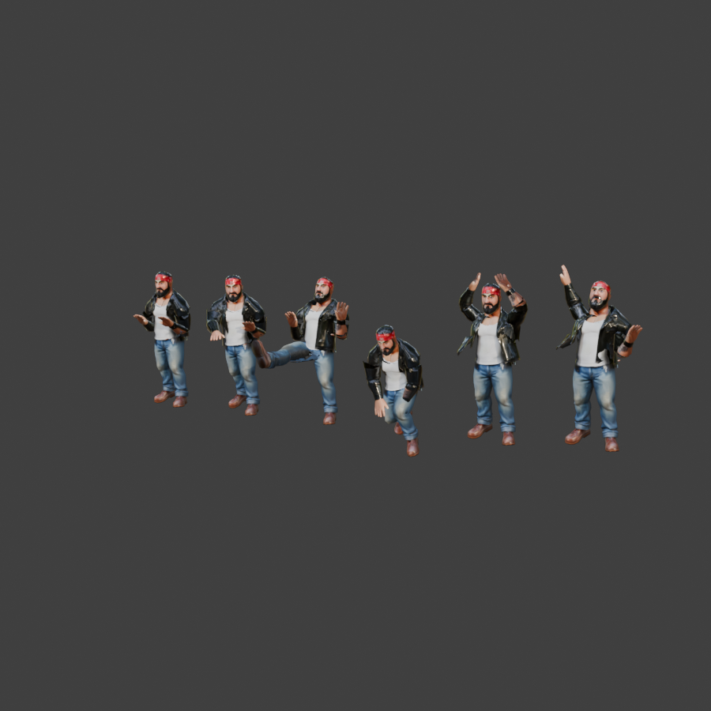

# Asset pipeline

Made by Ariana Mischa Fadhila of Syubadubin Studios. · [Bahasa Indonesia](../id/ALUR-ASET.md)

```
Concept prompt ─► Rodin MCP (Generate3DFromPrompt) ─► assets/source/rodin/<key>.glb   (raw, 8–9 MB each)
                                                         │
                  Blender MCP ─► tools/blender/sijenggo_pipeline.py
                                  normalise → decimate (LOD0 / LOD1) → shrink textures
                                  → humanoid armature from mesh landmarks → skin weights
                                  → 25 keyframed fighting clips → export glTF
                                                         │
                                                         ▼
                                  assets/models/<key>.glb, <key>_lod1.glb  (≈1 MB, 4.5k tris)
                                                         │
                  ThreeNet: Scene.LoadModelCached → clips by name → ActorAnimator scrubs them
```




## What the Blender script does

`build_character(key, source, out_dir, height)`:

1. **Normalise**: feet at Z = 0, centred, scaled to the character's height, transforms applied.
2. **Textures** downscaled to 1024 px; **decimate** to 14k faces (LOD0) and 4.5k (LOD1).
3. **Rig**: 20 bones (`root, hips, spine, chest, neck, head, shoulder/upper_arm/forearm/hand.L/R,
   thigh/shin/foot.L/R`). Joint positions are measured from the T-pose mesh (arm band height, hand extremity,
   leg centres), so any humanoid from Rodin fits.
4. **Skin**: bone-heat weights; if the generated mesh is not watertight, bone heat runs on a voxel-remeshed
   proxy and the weights are transferred back (Data Transfer); envelopes only as a last resort.
5. **Animate**: 25 clips authored as poses in armature space: `idle, walk, jab, cross, hook, uppercut, kick,
   roundkick, sweep, spin, slam, slash, thrust, grab, throw, carry, cast, roar, counter, hit, knockdown, getup,
   jump, downed, victory`. Each attack clip is "anticipation → impact (in the middle) → recovery"; the game
   maps move frame data onto that timeline.
6. **Export** glTF binary with skins and one animation per NLA track, JPEG textures.

`build_prop(key, source, out_dir, size, long_axis_up)` grounds, scales, decimates and exports props, weapons
(blade along +Y for the hand bone) and food.

`contact_sheet(rig, mesh, shots)` lays out frozen poses for a visual check through Blender MCP's `look`.

## Per-character animation styles

`tools/blender/character_styles.py` gives the heroes and bosses their own clips on top of the shared set. It
opens the exported models, replaces some clips and adds new ones, and re-exports LOD0 and LOD1. It runs headless
(no MCP needed):

```bash
blender --background --factory-startup --python tools/blender/character_styles.py            # all styled models
blender --background --factory-startup --python tools/blender/character_styles.py -- bima    # just one
blender --background --factory-startup --python tools/blender/preview_clips.py -- bima out.png idle:1 victory:31
```

| Model | Signature clips |
|---|---|
| Jenggo | `idle` hunched brawler bob, `victory` double-biceps flex, new `taunt` (beckons while a boss is introduced) |
| Bima | `idle`/`walk` low kuda-kuda silat stance with open hands, `victory` sembah salute |
| Rani | `idle` hand at the earpiece, new `gadget` wrist-device aim (her gadget specials), `victory` hands on hips |
| Ucup | `idle` tasbih at the chest, `spin` arms-wide sarong whirl, `victory` doa |
| 7 bosses | new `intro`, played during the boss intro cinematic (chest pound, anchor raise, rising sorcery, axe, hammer slam, temple bow and draw, wings) |

`ActorAnimator` falls back to the shared clip when a rig lacks a new one (`gadget -> jab`, `taunt`/`intro -> roar`).
The script keeps a short note of the pose axes; `preview_clips.py` renders a contact sheet for review.


## Voice lines

```
tools/voice/lines.json -> tools/voice/generate.py (Rodin MCP -> ElevenLabs v3) -> assets/source/voice/*.mp3
                       -> tools/voice/convert.py (ffmpeg, trim, peak-normalise) -> assets/voice/*.wav (22 kHz mono)
```

48 lines: intro, two phase taunts and defeat for each boss, and five barks per hero (ultimate, special, revive,
down, victory). `generate.py` drives the Rodin MCP server over stdio and retries, because the server answers
"Failed to initiate" now and then. In the game `VoiceBank` decodes the WAVs on first use and `AudioDirector`
plays one voice at a time (boss lines beat barks, barks are rate-limited, the music ducks under speech). A missing
file is simply silent; the subtitles still show. `PresentationTests` checks every cue has a decodable file.

## Adding a new character

1. Generate a T-pose model with Rodin (prompt: "full body ... standing in T-pose, arms straight out
   horizontally, facing forward") and save it to `assets/source/rodin/<key>.glb`.
2. In Blender (MCP `execute_blender_code`):
   ```python
   exec(open(r"<repo>/tools/blender/sijenggo_pipeline.py").read())
   build_character("<key>", r"<repo>/assets/source/rodin/<key>.glb", r"<repo>/assets/models", height=1.8)
   ```
3. Map the visual to the key in `Presentation/Actors/ActorManager.ModelKey`.

Anything without a model falls back to procedural geometry (`ProceduralModels`), so the game always runs.

## Inventory

- 17 rigged characters: 4 players, 6 enemies (the Patih's shadows reuse the ninja), 7 bosses.
- 21 static models: 8 props, 8 weapons, 5 food/loot pickups.
- 2D art (Rodin image generation): key art and four character portraits in `src/SiJenggo.App/Assets/Art`.
- `assets/source` holds the raw generations (~370 MB). Keep it out of Git or use Git LFS; the exported
  `assets/models` (~33 MB) is what the game needs.
