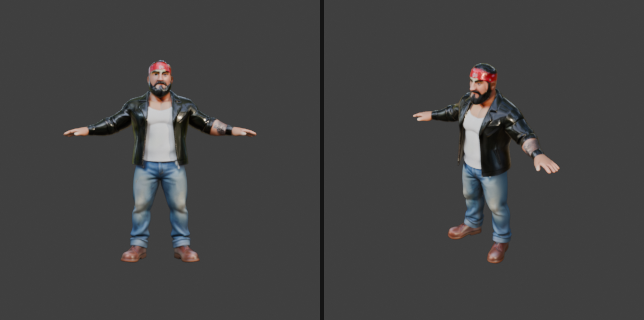
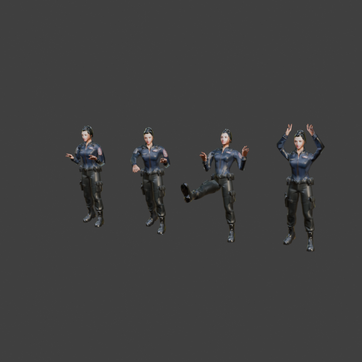
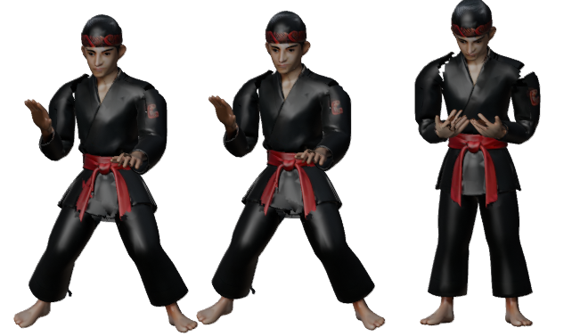
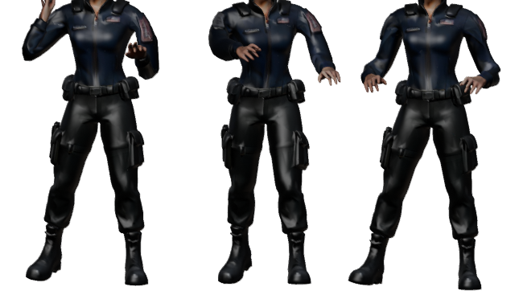
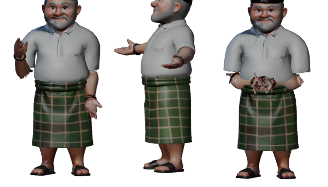
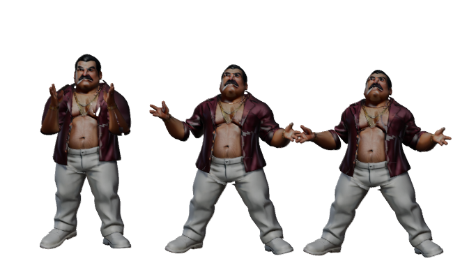

# Alur aset

Dibuat oleh Ariana Mischa Fadhila dari Syubadubin Studios. · [English](../en/ASSET-PIPELINE.md)

```
Prompt konsep ─► Rodin MCP (Generate3DFromPrompt) ─► assets/source/rodin/<key>.glb   (mentah, 8–9 MB)
                                                       │
                 Blender MCP ─► tools/blender/sijenggo_pipeline.py
                                normalisasi → decimate (LOD0 / LOD1) → kecilkan tekstur
                                → armature humanoid dari titik anatomi mesh → bobot skin
                                → 25 klip animasi bertarung → ekspor glTF
                                                       │
                                                       ▼
                                assets/models/<key>.glb, <key>_lod1.glb  (≈1 MB, 4,5 ribu segitiga)
                                                       │
                 ThreeNet: Scene.LoadModelCached → klip per nama → ActorAnimator men-scrub-nya
```




## Yang dikerjakan skrip Blender

`build_character(key, source, out_dir, height)`:

1. **Normalisasi**: kaki di Z = 0, di tengah, diskalakan ke tinggi karakter.
2. **Tekstur** dikecilkan ke 1024 px; **decimate** ke 14 ribu face (LOD0) dan 4,5 ribu (LOD1).
3. **Rig**: 20 tulang. Posisi sendi diukur dari mesh T-pose (tinggi lengan, ujung tangan, pusat kaki), jadi
   humanoid apa pun dari Rodin cocok.
4. **Skin**: bobot bone-heat; jika mesh hasil generate tidak rapat, bone-heat dijalankan pada proxy voxel-remesh
   lalu bobotnya ditransfer balik (Data Transfer); envelope hanya sebagai pilihan terakhir.
5. **Animasi**: 25 klip (`idle, walk, jab, cross, hook, uppercut, kick, roundkick, sweep, spin, slam, slash, thrust,
   grab, throw, carry, cast, roar, counter, hit, knockdown, getup, jump, downed, victory`). Tiap klip serangan
   berpola "ancang-ancang → benturan (di tengah) → pulih"; game memetakan frame data jurus ke garis waktu itu.
6. **Ekspor** glTF biner berisi skin dan satu animasi per track NLA, tekstur JPEG.

`build_prop(...)` mengerjakan prop, senjata (bilah sepanjang +Y untuk tulang tangan), dan makanan.
`contact_sheet(...)` menata pose-pose beku untuk dicek lewat `look` di Blender MCP.

## Gaya animasi per karakter

`tools/blender/character_styles.py` memberi para pahlawan dan bos klip khas di atas set bersama. Skrip ini membuka
model hasil ekspor, mengganti sebagian klip dan menambah klip baru, lalu mengekspor ulang LOD0 dan LOD1. Bisa
dijalankan tanpa layar (tidak perlu MCP):

```bash
blender --background --factory-startup --python tools/blender/character_styles.py            # semua model bergaya
blender --background --factory-startup --python tools/blender/character_styles.py -- bima    # satu saja
blender --background --factory-startup --python tools/blender/preview_clips.py -- bima out.png idle:1 victory:31
```

| Model | Klip khas |
|---|---|
| Jenggo | `idle` jagoan membungkuk, `victory` pamer otot dua lengan, `taunt` baru (menantang saat bos diperkenalkan) |
| Bima | `idle`/`walk` kuda-kuda silat rendah dengan tangan terbuka, `victory` sembah |
| Rani | `idle` tangan di earpiece, `gadget` baru membidik dengan alat di pergelangan (jurus gadget), `victory` tangan di pinggang |
| Ucup | `idle` tasbih di dada, `spin` putaran sarung dengan lengan terbentang, `victory` doa |
| 7 bos | `intro` baru, dimainkan saat sinematik perkenalan bos (memukul dada, mengangkat jangkar, sihir melayang, kapak, hantaman palu, hormat dan menghunus, sayap) |

`ActorAnimator` kembali ke klip bersama bila rig tidak punya klip baru (`gadget -> jab`, `taunt`/`intro -> roar`).
Skrip menyimpan catatan singkat sumbu pose; `preview_clips.py` merender lembar pose untuk ditinjau.






## Rekaman suara

```
tools/voice/lines.json -> tools/voice/generate.py (Rodin MCP -> ElevenLabs v3) -> assets/source/voice/*.mp3
                       -> tools/voice/convert.py (ffmpeg, potong, normalisasi puncak) -> assets/voice/*.wav (22 kHz mono)
```

48 baris: intro, dua ejekan fase, dan kalimat kalah untuk tiap bos, serta lima teriakan per pahlawan (pamungkas,
spesial, bangkit, tumbang, menang). `generate.py` menjalankan server Rodin MCP lewat stdio dan mengulang
permintaan, karena server sesekali menjawab "Failed to initiate". Di dalam game `VoiceBank` mendekode WAV saat
pertama dipakai dan `AudioDirector` memutar satu suara sekaligus (kalimat bos mengalahkan teriakan, teriakan
dibatasi frekuensinya, musik diturunkan saat ada suara). File yang hilang cukup diam; subtitle tetap tampil.
`PresentationTests` memastikan setiap cue punya file yang bisa didekode.

## Menambah karakter baru

1. Buat model T-pose dengan Rodin dan simpan di `assets/source/rodin/<key>.glb`.
2. Di Blender (MCP `execute_blender_code`):
   ```python
   exec(open(r"<repo>/tools/blender/sijenggo_pipeline.py").read())
   build_character("<key>", r"<repo>/assets/source/rodin/<key>.glb", r"<repo>/assets/models", height=1.8)
   ```
3. Petakan visualnya di `Presentation/Actors/ActorManager.ModelKey`.

Objek tanpa model memakai geometri prosedural (`ProceduralModels`), jadi game selalu bisa berjalan.

## Inventaris

- 17 karakter ber-rig: 4 pemain, 6 musuh (bayangan Patih memakai model ninja), 7 bos.
- 21 model statis: 8 prop, 8 senjata, 5 makanan/barang.
- Seni 2D (generate gambar Rodin): key art dan empat potret karakter di `src/SiJenggo.App/Assets/Art`.
- `assets/source` berisi hasil generate mentah (~370 MB). Jangan masukkan ke Git atau gunakan Git LFS; game hanya
  butuh `assets/models` (~33 MB).
