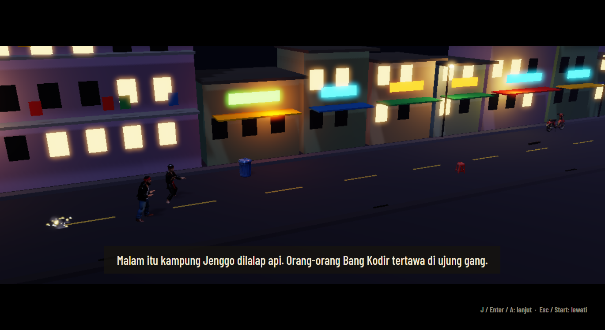
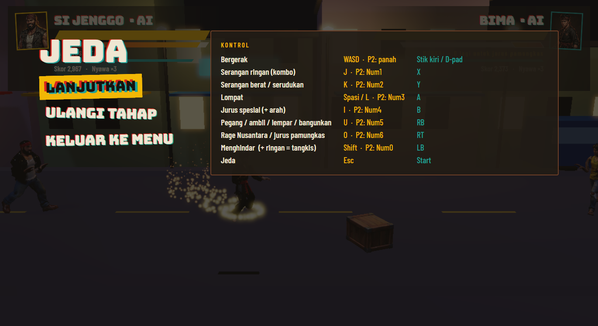
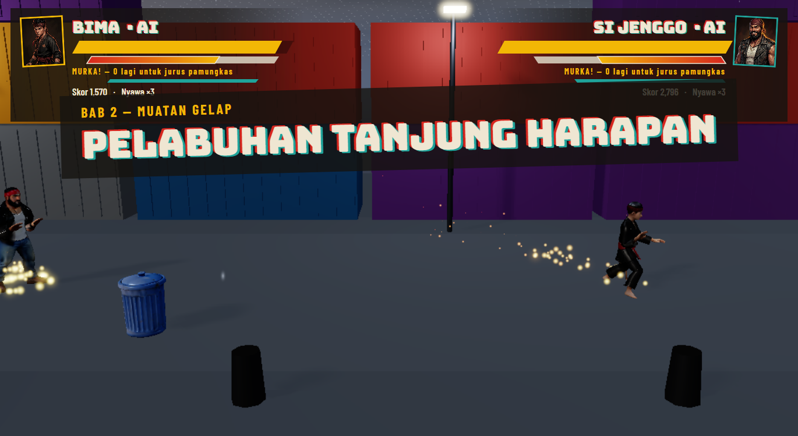
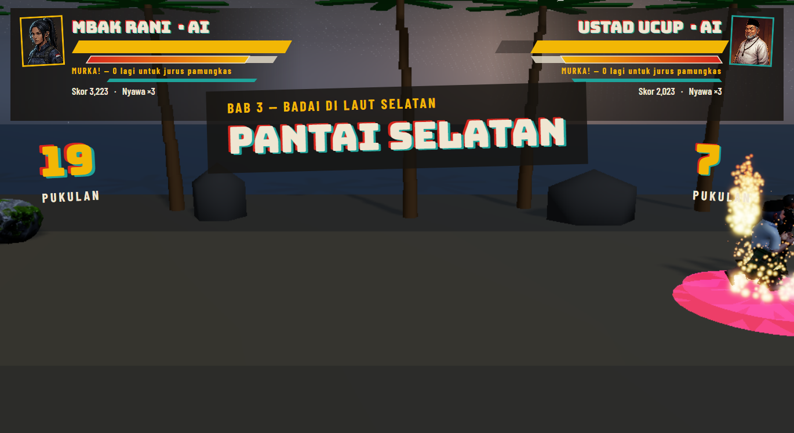
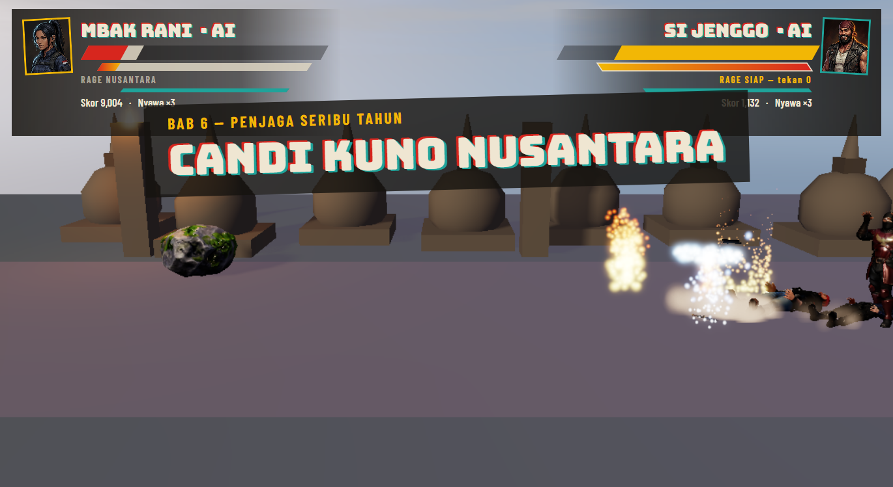
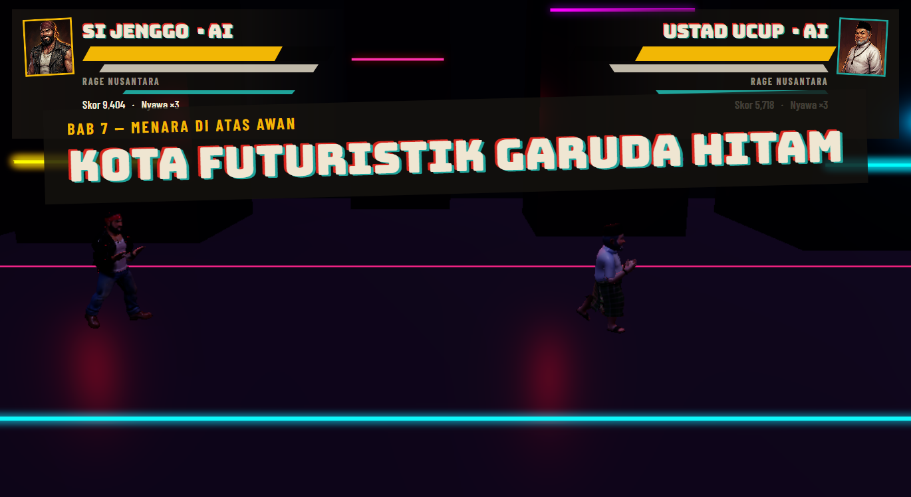
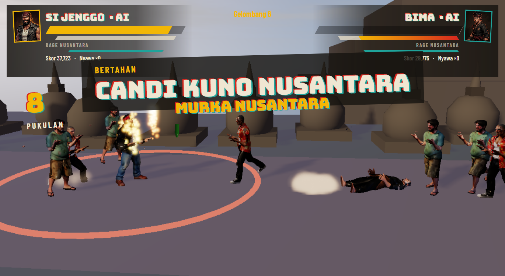
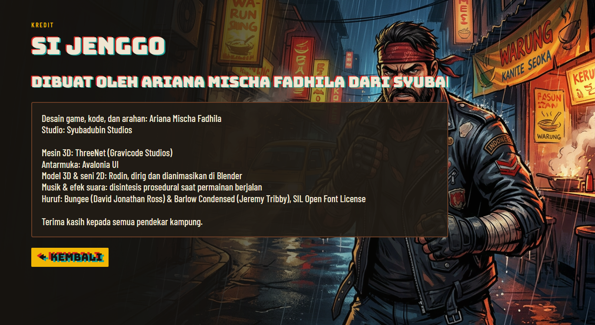

# Si Jenggo — Dokumentasi (Bahasa Indonesia)

Dibuat oleh Ariana Mischa Fadhila dari Syubadubin Studios. · [English version](../en/README.md)

| Dokumen | Isi |
|---|---|
| [ARSITEKTUR.md](ARSITEKTUR.md) | Proyek, ECS, simulasi fixed-step, cara render mencerminkannya, aturan performa |
| [GAMEPLAY.md](GAMEPLAY.md) | Aturan bertarung, rage, jurus, co-op, AI, bos, bab, progresi, mode |
| [ALUR-ASET.md](ALUR-ASET.md) | Rodin → Blender (rig, animasi, LOD) → ThreeNet, dan cara menambah model |
| [JARINGAN.md](JARINGAN.md) | Lockstep deterministik dan rollback, format paket, server relay |
| [KESEIMBANGAN.md](KESEIMBANGAN.md) | Sweep keseimbangan AI tanpa layar, target, riwayat penyetelan ([laporan, EN](../en/balance-report.md)) |
| [../../PLAN.md](../../PLAN.md) | Rencana pengembangan |
| [../../Progress.md](../../Progress.md) | Yang sudah selesai dan terverifikasi |

## Mulai cepat

```bash
dotnet run --project src/SiJenggo.App
```

Kualitas grafis bisa dipaksa dari baris perintah: `--quality 0` (rendah, untuk GPU terintegrasi) sampai `--quality 3`.

## Screenshot

| | |
|---|---|
|  Sinematik bab dalam engine |  Menu jeda dan kontrol |
|  Bab 2 — pelabuhan |  Bab 3 — badai di pantai |
|  Bab 6 — candi kuno |  Bab 7 — kota Garuda Hitam |
|  Mode Bertahan |  Kredit |

Semua screenshot diambil langsung dari game lewat `SiJenggo --capture docs/screenshots`, yang memainkan game dengan dua petarung AI.
